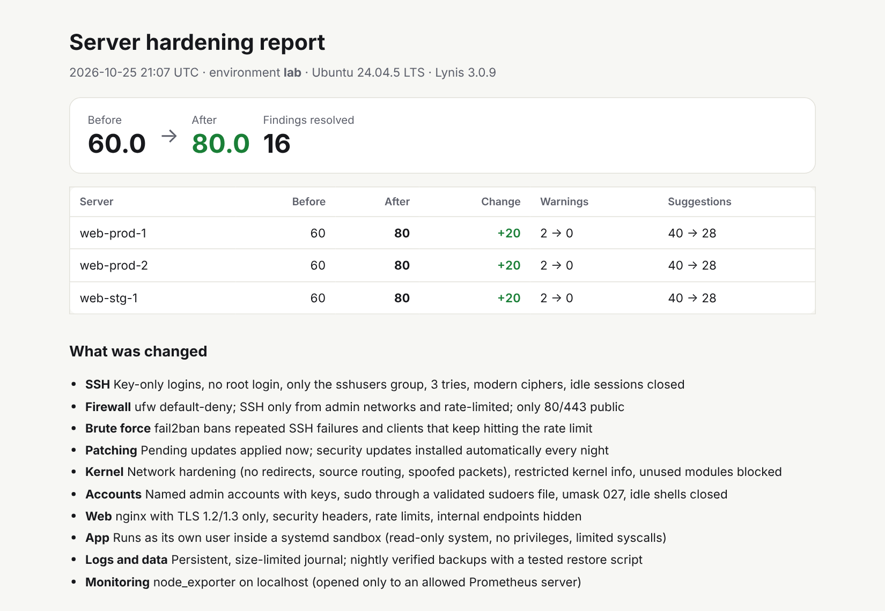
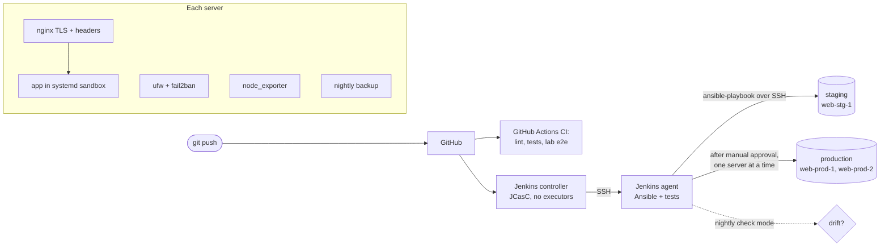

# ServerForge

[](https://github.com/ObaidAbdullah16/serverforge/actions/workflows/ci.yml)


**Linux servers as code with Ansible and Jenkins. Hardened in one run, released with a
health gate and automatic rollback, checked for drift every night, and scored before
and after with a Lynis audit.**

> **Demo lab.** The "servers" are throwaway Docker containers on your laptop, or two tiny
> EC2 instances that run only during a demo. The roles are written for real Ubuntu
> 22.04/24.04 servers. Lab scores differ from real VMs (kernel checks don't apply to containers).



## What this project shows

| Area | What is in it |
|---|---|
| **Configuration management** | 8 Ansible roles (baseline, firewall, fail2ban, nginx, app, monitoring, backup, lynis). They are idempotent, and CI fails if a second run changes anything. `ansible-lint` passes the strictest `production` profile. |
| **Server hardening** | Key-only SSH with `AllowGroups`, validated before reload so a bad config can't lock you out. Also default-deny ufw, fail2ban, nightly security patches, kernel/network sysctls, unused kernel modules blocked, TLS 1.2/1.3 only. |
| **Measured result** | `before-after.sh` audits fresh servers with Lynis, hardens them, audits again and writes a client-ready report. In the container lab the score goes from **60 to 80**. |
| **Safe releases** | Reproducible artifact with a SHA-256 check. Atomic symlink switch, rolling deploy one server at a time, health gate, **automatic rollback**, one-command rollback. |
| **Jenkins CI/CD** | Jenkins entirely from code (plugins + JCasC), with a controller/agent split over SSH. The declarative `Jenkinsfile` runs lint, tests, artifact, staging, manual approval and production. A nightly drift job runs too. |
| **Drift detection** | `site.yml --check --diff` every night. It catches hand edits (e.g. SSH passwords switched back on) and firewall rules opened by hand. |
| **App security** | The app runs as its own user in a systemd sandbox: read-only system, no capabilities, limited syscalls, private /tmp. |
| **Infrastructure as code** | Terraform for the AWS lab: IMDSv2 only, encrypted disks, "standard" CPU credits (no surprise bill), SSH only from your IP. |
| **Same pipeline twice** | Jenkins (`Jenkinsfile`) and GitHub Actions (`ci.yml`), compared in [docs/JENKINS-vs-GITHUB-ACTIONS.md](docs/JENKINS-vs-GITHUB-ACTIONS.md). |

## Architecture



## Quick start: local lab (free)

Needs Docker Desktop and WSL (Ubuntu). Ansible is installed into `.venv` automatically.

```bash
bash scripts/lab-up.sh                 # 3 Ubuntu 24.04 servers in Docker
bash scripts/before-after.sh           # audit -> harden -> audit  => reports/before-after/report.html
bash scripts/build-app.sh              # dist/serverforge-app-1.0.0.tar.gz + .sha256
bash scripts/deploy.sh staging         # https://localhost:8441 (self-signed certificate warning is expected)
bash scripts/deploy.sh production      # rolling: web-prod-1, then web-prod-2
bash scripts/lab-down.sh             # containers + volumes (keeps the built images: fast restart)
bash scripts/lab-down.sh --all       # also deletes the images it built
```

Break things on purpose:

```bash
# (needs a working release on the servers first: the deploy commands above)
VERSION=1.1.0 bash scripts/build-app.sh --broken && bash scripts/deploy.sh production
#   -> fails the health check on web-prod-1, rolls it back, never touches web-prod-2
VERSION=1.2.0 bash scripts/build-app.sh && bash scripts/deploy.sh production
bash scripts/rollback.sh production    # back to 1.0.0: rollback skips releases that failed their health check
bash scripts/simulate-drift.sh         # "quick manual fix" on web-prod-1
bash scripts/drift.sh                  # exit 2: drift found (details in reports/)
bash scripts/site.sh                   # put the servers back to what the code says
```

## Jenkins

```bash
bash scripts/lab-up.sh --with-jenkins  # http://localhost:8085 (password is printed)
```

Two jobs come from `jenkins/casc.yaml`:

* **serverforge-release**: lint, tests, artifact, staging, *approve*, production. Jenkins
  clones the repository from GitHub, so push first. Use *Build Now* once, then *Build with
  Parameters* to choose `release`, `rollback-production` or `harden-only`, or to ship a
  deliberately broken release.
* **serverforge-drift**: runs every night. The build turns *unstable* when a server no
  longer matches the code.

## AWS lab (on demand, ~$0.03/hour)

Uses the shared `aws-foundation` setup (state bucket, budgets, GitHub OIDC role).

```bash
bash scripts/aws-up.sh                     # 2 x t4g.micro, SSH open to your IP only
INV=aws bash scripts/before-after.sh       # real VM scores
bash scripts/build-app.sh && INV=aws bash scripts/deploy.sh staging
bash scripts/aws-down.sh                   # deletes everything in AWS (--all also deletes the lab SSH key)
```

Or **Actions → Showcase on AWS → Run workflow**. It creates fresh servers, audits, hardens,
deploys and audits again, uploads the report and deletes everything, for about one cent.
**Auto-stop** deletes a forgotten AWS lab every night at 00:00 IST.

## Repository layout

```
roles/                 baseline, firewall, fail2ban, nginx, app, monitoring, backup, lynis
playbooks/             site, harden, deploy, rollback, audit, backup-test
inventories/lab|aws/   hosts and per-environment settings
app/                   the demo app (Python standard library) + tests
jenkins/               controller + agent images, plugins.txt, casc.yaml
Jenkinsfile            release pipeline;  Jenkinsfile.drift: nightly drift check
lab/                   Docker "servers" (systemd + SSH) and the compose file
infra/terraform/       AWS lab (VPC, security group, 2 instances)
scripts/               lab-up/down, aws-up/down, site, deploy, rollback, audit, before-after, drift
tools/                 hardening_report.py (Lynis -> Markdown/HTML/JSON) + tests
sample-report/         a real before/after report from the lab
docs/                  architecture, runbook, security, costs, Jenkins vs Actions, service playbook
```

## Design decisions

| Decision | Why | Trade-off |
|---|---|---|
| Ansible over SSH, no agent on servers | Nothing to install or patch on the servers; works on any VPS | Slower than a pull model at hundreds of servers |
| Ubuntu packages (nginx, node_exporter, Lynis) | Patched by unattended-upgrades with everything else | Slightly older versions than upstream |
| Release = tarball + symlink, not containers | Shows the classic VM workflow most small companies still run; rollback in one second | No image layer caching; Python stdlib only |
| Rolling `serial: 1` + `max_fail_percentage: 0` | A bad release hits one server, then stops | Slower releases on big fleets |
| Firewall rules tagged `sf:` and unknown rules removed | The firewall is exactly what the code says | Someone's manual rule disappears at the next run (by design) |
| Lab servers are privileged systemd containers | Free, fast and close to a VM | Kernel checks don't apply; never run apps like this |

## License

MIT
