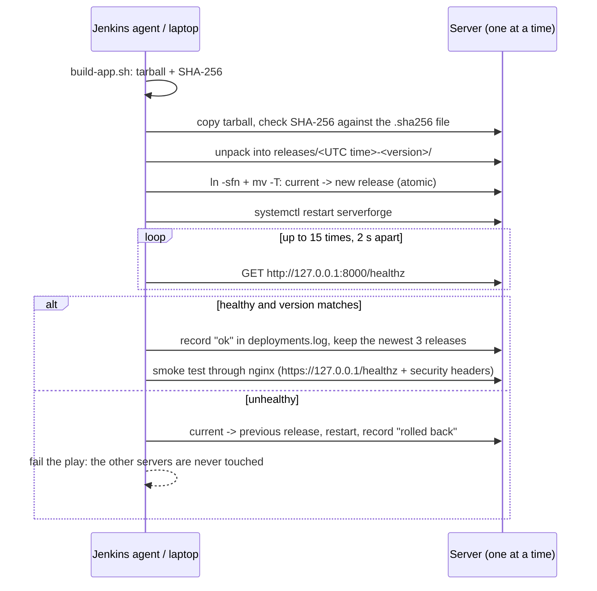
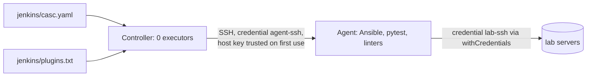

# Architecture

## Two loops

1. **Configuration** (`site.yml`): makes every server match the code. It runs at the
   start of each release and every night in check mode (drift detection).
2. **Release** (`deploy.yml`): installs a new version of the app with a health gate.

## What runs on each server

| Piece | Where | Notes |
|---|---|---|
| nginx | :80 (redirect), :443 | TLS 1.2/1.3, security headers, rate limit on `/api/`, `/metrics` localhost only |
| app (`serverforge.service`) | 127.0.0.1:8000 | Python stdlib, systemd sandbox, user `serverforge` |
| code | `/opt/serverforge/releases/*`, `current` symlink | owned by root, read-only for the app |
| data | `/var/lib/serverforge/data/notes.json` | the only writable path for the app |
| node_exporter | 127.0.0.1:9100 | opened in ufw only for `monitoring_scrape_cidrs` |
| backups | `/var/backups/serverforge/` | systemd timer 02:30 UTC, 7 kept, optional S3 copy |
| fail2ban | - | `sshd` + `nginx-limit-req` jails, bans through ufw |

## Environments

| | Lab (Docker) | AWS |
|---|---|---|
| Servers | `web-stg-1`, `web-prod-1`, `web-prod-2` | `web-stg-1`, `web-prod-1` (t4g.nano) |
| Reached from laptop | 127.0.0.1:2221-2223 (SSH), 8441-8443 (HTTPS) | public IPs, SSH from your IP only |
| Reached from Jenkins | container names on the compose network | not wired (use the Showcase workflow) |
| Login user | `ansible` (image) | `ubuntu` (AMI) |
| Inventory | `inventories/lab/hosts.yml` | `inventories/aws/hosts.yml` (written by `aws-up.sh`) |

## Jenkins

Nothing is clicked by hand. Delete the containers and `lab-up.sh --with-jenkins` builds the
same Jenkins again: users, credentials, the agent and both jobs.
